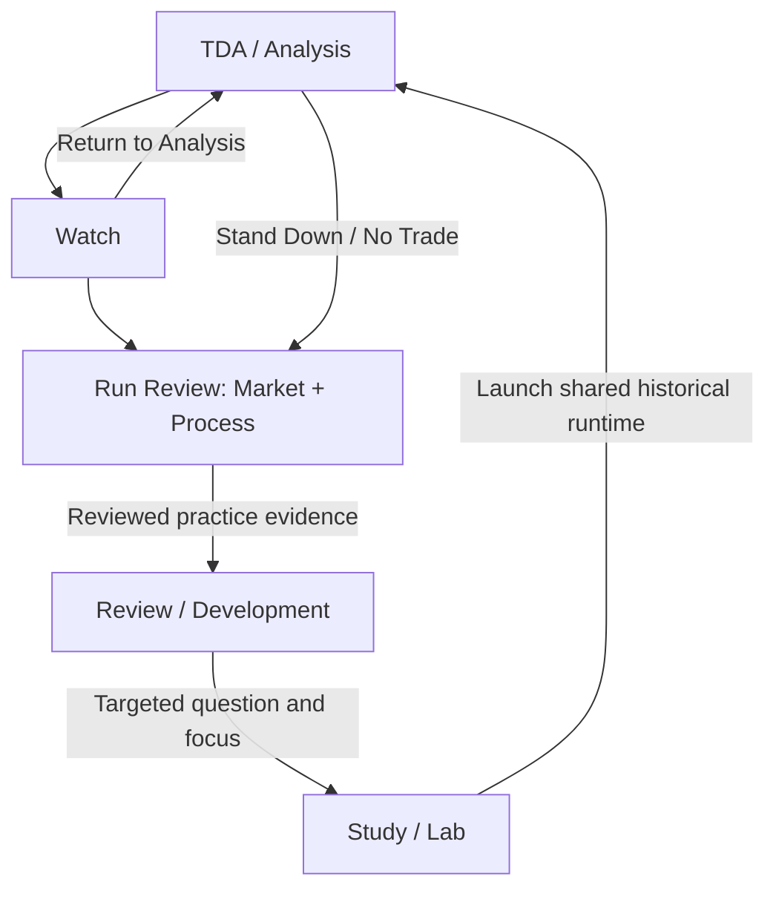

# Cockpit-wide functional walkthrough

**Status:** Architectural and operator review aid; final rendering and production QT changes are not approved by this document.
**Verified baseline:** accepted E7 on main `83d82323ca936dedf045027760d81a1cd7de76b1`; schema v37, Trade Plan Alpha 0.7. This design branch changes documentation only.
**Purpose:** Review the whole operating/learning experience before refining a QT component. Separate what currently exists, what is required, and what is proposed.
**Operator review:** walkthrough reviewed on 2026-10-11; ready to continue to shared behavior-contract review. This does not settle the three open contracts or approve a final renderer.
**Subsequent contract decision:** automatic interpretation recording and in-place Watch updates accepted on 2026-10-11; comparison baseline remains open.

## 1. The whole tool

The Trade Plan defines the current system. Process operates it. Study investigates and trains. Review / Development improves it. Workbench supports specific configuration and publishing needs. These areas share structured records and provenance without requiring identical interfaces.

| Functional area | Technician's question | Current foundation | Intended presentation / remaining work |
| --- | --- | --- | --- |
| Foundation | What am I working on, and under what personal/market assumptions? | Plan-owned Foundation section and descriptive topics | Familiar orientation and relevant definitions; not a new required intake form |
| Rules / Safety | What permits or prevents this action, and why? | Run/candidate gates, explicit context effects, progression-policy and governance surfaces | Explain state, reason and remedy; preserve entry/exit separation |
| Playbooks | Which methods or day-specific opportunities am I considering? | Named playbook definitions, run snapshots, multiple candidates and custom/day-specific setups | Inspect useful model context; future revisioned editing is distinct from operating a run |
| TDA / Analysis | What is my interpretation, draw, thesis and next meaningful observation? | Two analytical decks, Focus/Deck views, station state, QT editor at Thesis, watch-point/model selection | Analytical whole-stack orientation with nearby detail and intentional completion |
| Watch | Where am I in the unfolding context, and what matters now? | Carry-forward thesis, observations, thesis-state changes, watch points, candidates, authorization and market context | Quiet at-a-glance AMDX orientation and efficient permitted capture beside TradingView |
| Post-Market Review | What changed, how did I operate, and what deserves follow-up? | Market Review / Process Review, separate observed QT values, outcome/adherence/takeaway, focused Study review | Contextual reconstruction and useful follow-up; no quarter-correctness grading |
| Study / Lab | What question am I investigating, what did I observe, and what did I learn? | Historical Backtest launch with explicit question/time, optional hypothesis/scope/competency focus, shared runtime and Study outcome | Spacious investigation with foundational whole-stack context; this dedicated presentation is not implemented |
| Review / Development | What does the accumulated evidence suggest I should do next? | Evidence, synthesis, Cross-Run Observation, Development Direction, Evidence Maturity, progression standing and targeted practice launch | Evidence-led learning/revision decisions with clear separation of governance states |
| Workbench | What definition or presentation configuration am I changing? | Summary-template working copies and immutable revision publishing | Broader configuration only as concrete needs justify it; generic plan/playbook/process editing is not implemented |
| Capture / knowledge support | How do I retain a useful observation without documenting it twice? | Study Find, Trade Summary, Study Review, drafts and generated summaries | Later source links/Learning Inbox/Trilium support; learning inputs remain distinct from competency evidence |

This is a functional map, not a proposed set of nine mandatory tabs. A section's current presence does not imply its mature UX is complete.

## 2. Where those functions actually live today

The actual top-level tabs are **Trade Plan, Guided TDA, Study Find, Trade Summary, Study Review, Workbench**. There is not yet a standalone top-level Lab workspace. The conceptual structure above should not be mistaken for the current navigation labels.

| Current route | What it opens | Important distinction |
| --- | --- | --- |
| Trade Plan → Foundation | Plan identity/purpose/topics | Descriptive plan content does not imply a fully editable configuration system |
| Trade Plan → Rules / Safety | Rule definitions and progression-policy/governance controls | Definitions and human governance are distinct from a particular candidate's live authorization |
| Trade Plan → Process → Process Map | Blueprint of modes/decks/stations/transitions | Inspecting the map does not complete analytical work |
| Trade Plan → Process → Run Trading Day | Trading Day and active Trading Run shell | The main run-owned TDA → Watch → Review operating path |
| Trade Plan → Process → Calendar captures | Local provider capture import/selection | Selected capture/snapshot provenance; no automatic source completeness or network-refresh guarantee |
| Trade Plan → Playbooks | Reference model definitions | Operating candidates use recorded snapshots rather than editing a definition in place |
| Trade Plan → Review / Development → Evidence | Reviewed evidence and competency synthesis | Reviewing evidence is distinct from capturing a raw learning note |
| Trade Plan → Review / Development → Interpretation | Cross-Run Observation, Development Direction and Evidence Maturity work | These are separate human-authored governance records, not one score |
| Trade Plan → Review / Development → Progression | Eligibility/standing and attainment/regression/revalidation work | Current eligibility and historical attainment remain separate |
| Trade Plan → Review / Development → Practice & Launch | New Process Run launcher and targeted study routing | Historical Backtest, Replay, Forward Test and Live enter the shared runtime |
| Guided TDA | Standalone guided analysis/draft form | Separate existing entry point; do not silently equate it with the run-owned station workflow or remove it during QT work |
| Study Find / Trade Summary | Capture and generated summary tools | Structured records are authoritative; generated prose is a projection |
| Study Review | Stored Study Find review | Not the same surface as run Market Review, Review / Development, or the intended spacious Lab |
| Workbench | Summary-template publishing | Template revisions change presentation, not trading permissions |

Multiple existing entry points need coherent orientation. Consolidating them is a future reviewed information-architecture decision, not a prerequisite for the shared QT contract.

## 3. Four different kinds of position

| Position | Example | What it means |
| --- | --- | --- |
| Environment | Historical Backtest, Replay, Forward Test, Live | How market information is presented; default purposes are Study, Rehearsal, Validation and Execution |
| Process position | TDA, Watch, Post-Market Review | What the technician is doing inside the run |
| Analytical position | Deck, station, Focus/Deck view | Which operation is in focus and how it relates to the larger analysis |
| Market position | Futures day, session, 90-minute interval, higher-order QT context | Where the explicit market reference sits in the temporal hierarchy |

Changing a renderer or selecting an interval does not change the environment, certify a station, advance a process, or create a new run. The normal Trading Run can span multiple market sessions. Additional runs are deliberate new process contexts.

The operator confirms the Focus/Deck relationship as the right microcosm for nearby detail and bird's-eye orientation. Mature UX should bring these together rather than use tabs to separate them. Existing tab navigation is documented as current behavior, not the final design.

This shows the operating/learning relationship, not automatic promotion or a mandatory navigation chain. Review / Development is directly enterable; Study is an environment/intent, not an extra stage after Run Review.

## 4. Operating journey: analysis through review

This is a conceptual walkthrough, not a new manual acceptance checklist. It uses a hypothetical Replay run so that market-time context is explicit. No real market outcome or trading recommendation is asserted.

**Enter the run.** From Practice & Launch, select Replay and an explicit New York market reference. Optional practice intent remains separate from environment. The run records the governing Trade Plan revision and relevant policy/model/context snapshots. Trading Day contains the run; sessions remain market context inside it.

**Build the analysis.** In the run's TDA, Higher-Timeframe Context covers Instrument / Session Context, IPDA Premium / Discount, Monthly Liquidity / Wick CE, Weekly Context and Daily Context. Thesis / Execution Context covers Primary Draw, Secondary / Alternate Draw and Premarket Thesis. Focus supports the operation at hand; Deck supplies the spatial analytical overview. Chart work occurs in TradingView; these correspondences do not imply electronic chart control.

**Place AMDX in that analysis.** Currently the flat QT editor appears in the Thesis station's Focus view. The proposed architecture keeps whole-stack context available through the analytical journey with detail appropriate to the station. An expectation belongs to the run and explicit target interval; selecting another scope should preserve the larger picture. The final TDA station/content layout remains open.

**Finish deliberately.** Station certification and the TDA-to-Watch transition are intentional process actions. Ordinary recording/navigation does not certify completion. The existing intentional incomplete-override path preserves that incompleteness; it does not clear safety/setup gates.

**Operate in Watch.** Existing Watch carries forward thesis/context, tracks candidate/watch-point state, records material observations and thesis changes, and exposes authorization reasons. The proposed renderer should quietly orient the technician in the whole AMDX stack and promote only relevant detail. An efficient capture action does not need to become a large journal form. Expectation editing currently uses Return to Analysis. The subsequently accepted direction enables small working-phase changes directly in Watch and preserves easy full-stack/TDA access for broader re-analysis; that command is not yet implemented.

**Respond to change.** If a thesis needs re-analysis, the existing Return to Analysis transition is deliberate and preserves the run's history. Material changes can be captured in Watch without pretending that every observation is a new expectation. A passive interval boundary should update the current marker without retargeting an edit to a different interval.

**Conclude appropriately.** Finish Watch or choose Stand Down / No Trade and enter Review. No Trade is a first-class outcome. Recorded authorization means permission according to the process; the Cockpit does not currently submit NinjaTrader orders or automatically operate TradingView.

**Review the market, then the process.** Market Review displays saved TDA expectations, material Watch changes, observed QT and interpretation outcome. Process Review records adherence, takeaway and follow-up. Current QT comparison is flat and descriptive. Proposed interval/revision identity supports contextual comparison without overwriting the earlier interpretation or grading every quarter.

**Retain the result.** Completing the day/run is separate from saving values. Restart/restore should preserve identities, context and recorded outcomes. Reviewed practice evidence can subsequently be consumed in Review / Development; a changed AMDX label alone does not create competency evidence.

## 5. Learning journey: insight to investigation and practice

**Enter improvement directly.** Review / Development can be entered without finishing a trading day. A reviewed run, repeated unexplained change, external learning input, or existing competency question can motivate work here; they are different kinds of input.

**Proposed default doorway.** In the mature UX, Study should be the most anticipated/startup workspace, especially while a validated successful Trade Plan is being built. A dismissible Study this Competency / next-study suggestion can reduce the mental effort of choosing useful work after a tiring day. It should explain its recorded basis and offer an easy route to other work. This is a proposed starting preference, not an implemented screen, study quota, eligibility change or automatic run launch. Handling active-run resume and recommendation ordering remains to be designed.

**Inspect the evidence.** Evidence/synthesis and Cross-Run Observation help make repeated patterns inspectable. Development Direction expresses what to work on next. Evidence Maturity judges usability for a progression boundary. These records are distinct from competency state, certifications, current eligibility and historical attainment.

**Launch a targeted study.** The current Study this competency / Practice & Launch pathway stages a Historical Backtest run with competency focus. Historical Backtest requires a study question and uses explicit historical market time; hypothesis and scope can add context. Launching practice does not itself upgrade eligibility or certify learning.

**Investigate with AMDX present.** Today that study runs through the shared TDA/Watch/Review runtime, including its existing QT/context substrate. The spacious Lab presentation is proposed: whole-stack orientation, nearby level/cycle detail, questions/hypotheses, examples and observations arranged for insight gathering. It uses the same domain contracts and its own reference/run ownership. It should not require a copy of the execution-oriented widget or a second AMDX database.

**Capture once.** Study Find and notes can retain observations. A future Learning Inbox/source-link workflow can reduce duplication with the external knowledge repository. Rich Trilium material may remain external; integration and source-aware linking are downstream. An instructional quote or Ah-ha note is a learning input, not proficiency evidence by itself.

**Review what was learned.** Focused Study review records outcome/notes and appropriate competency provenance. Supported, weakened or unresolved hypotheses can motivate more study without a fabricated success score. Preserve the environment/purpose of the evidence; Historical Study, Replay, Forward and Live are not interchangeable samples.

**Route the next practice.** Review / Development can guide Study, Rehearsal or Validation using explicit policy and human governance. The accepted ladder remains Lab teaches components → Replay integrates → Forward validates → Live executes. Returning to a lower environment is a supported remedy, not a punishment. No arbitrary readiness percentage or automatic promotion is introduced.

## 6. Shared AMDX backbone and different renderers

The architecture should separate four concerns:

| Concern | Owns | Must stay independent of |
| --- | --- | --- |
| Market context | Canonical New York clock, factual hierarchy, saved interval identity/bounds and source provenance | Human phase interpretation, directional claims and widget selection |
| Interpretation/history | Run-owned expected/observed values, revisions, notes and comparison identity | Renderer layout, current live clock and later definition changes |
| Application actions | Inspect/select scope, set interpretation, capture observation, return to analysis, certify/complete and route study within permissions | Mouse/shortcut/macro-pad binding and individual widgets |
| Presentation | Context-specific selection, disclosure, grouping and space | Independent domain truths or a second workflow |

| Presentation | Context that stays available | Task emphasis | More detail when useful |
| --- | --- | --- | --- |
| TDA | Whole-stack orientation, reference and selected scope | Form working interpretation, draw/thesis and expectations | Layer definition, prior-cycle relationship, context provenance |
| Watch | Quiet whole-stack orientation, current marker, working expectations | Relevant change, quick permitted capture and next action | Selected scope and reason for a state/action |
| Market Review | Historical reference and reconstructable whole-stack context | What changed, why, what deserves study | Identified expectation/observation revisions and source details |
| Study / Lab | Whole-stack context at the study's explicit reference | Relationships, examples, hypotheses and insight gathering | Spacious investigation and deliberately selected historical comparisons |
| Review / Development | Evidence-linked context when inspecting supported claims | Synthesis, learning direction and governance | Source run/interval/revision context behind a claim |
| Workbench | Relevant definitions/configuration provenance | Deliberate changes to definitions or presentation configuration | Candidate versus published revision differences |

Foundational availability does not require the same permanent widget in every governance/configuration page. Relevant context should remain reachable and oriented in the work being done. During TDA, Watch, Market Review and Study, quiet whole-stack visibility is the accepted direction. Clutter reduction hides secondary detail rather than demoting the higher-order stack.

## 7. What can progress now and what needs contract review

**Already established:** canonical time, futures-day rollover, raw fact/interpretation separation, run ownership, expected/observed separation, revision protection, shared operating/learning substrate, deliberate completion and input-action parity.

**Architecture work that can proceed without choosing a final layout:** specify stable target identity/bounds, versioned record shape and legacy restoration, context projection interfaces, action names/permissions and domain-level verification. Data work must preserve old values without inventing interval history. The existing `day`/`session`/`macro_90m` naming ambiguity is documented in `INTRADAY_QT_DESIGN.md`; conceptual view labels are not a migration rule.

Automatic interpretation recording and in-place Watch updates were subsequently accepted; the default comparison baseline remains a recommendation for discussion:

| Open contract | Proposed starting position | Consequence to examine |
| --- | --- | --- |
| Automatic draft capture → historical interpretation | Persist edits without a Save obligation. A deliberate phase selection can trigger an immutable interpretation revision through a shared action; unfinished note text can remain a recoverable draft. Saving never certifies a station. | Define exactly what creates a revision, how notes attach, error/retry behavior and how drafts restore after a crash. Avoid interpreting every keystroke as a new thesis. |
| Efficient Watch entry | Accepted: small working-phase changes use a directly reachable shared revision-preserving action in Watch. Broader thesis review retains easy full-stack/TDA access. Existing observation/thesis capture remains separate. | Distinguish observation from a revised expectation, protect timing/provenance, and avoid unnecessary navigation. Direct working-phase editing is accepted direction; exact control layout remains open. |
| Review expectation baseline | Preserve first explicit recorded expectation as a visible default; attach the chosen revision ID (or Unknown) to each observation. Allow explicitly identified later baselines when justified. | First expectation remains tentative; later revisions must not silently rewrite an earlier comparison, and retrospective entries must not masquerade as advance forecasts. |

These contracts deserve concrete examples before production behavior is committed. Final selector/button placement, renderer density and visual styling can be revisited afterward.

## 8. Immediate work sequence

1. Walkthrough reviewed on 2026-10-11; retain the clarified close overview/detail relationship and proposed Study-first doorway. Additional corrections can still be incorporated.
2. Automatic interpretation recording and in-place Watch updates are accepted. Review comparison baseline next using `QT_ACTION_CONTRACT_REVIEW.md`. This is architecture review, not approval of a UI layout.
3. Implement the narrow identity/persistence/action slice with developer verification and legacy/restart protection, once its contract is accepted.
4. Evaluate context-specific presentations in their working conditions: Watch beside charts, Lab during investigation, TDA during analysis, Review after the fact. Later shortcuts/hardware invoke the same actions.

This sequence keeps Milestone E moving and treats Milestone D as demonstrated friction. It does not start a broad UI rewrite, generic Workbench framework, broker bridge, embedded charting or scoring project.

## 9. Verification and source anchors

This walkthrough was checked against the source files below and the canonical requirements/decision audit. It changes no production code, schema, plan, tests or smoke-checklist statuses. The accepted 456-pass suite was not repeated for this documentation review. The preceding 17-assertion browser trial is exploratory evidence about that prototype, not verification of the mature presentation described here.

| Source | What was verified |
| --- | --- |
| `gui/main_window.py` | Exact top-level tabs, repository wiring, draft handling and summary tools |
| `default_trade_plan.py`, `default_process.py` | Plan sections, current model definitions, decks/stations and transitions |
| `gui/trade_plan_widget.py` | Process sub-tabs and Review / Development wiring |
| `gui/process_run_launcher_widget.py` | Shared runtime launch, environment/purpose, historical reference and intent/focus |
| `gui/trading_day_runtime_widget.py`, `gui/tda_station_runner_widget.py` | Runtime modes, Thesis-only QT attachment, Focus/Deck and deliberate transitions |
| `gui/trading_day_shell_widget.py`, `analysis/trading_session_run.py` | Run/time ownership, observation/review updates and persistence handoffs |
| `gui/live_watch_widget.py`, `gui/post_market_review_widget.py` | Actual capture, thesis/candidate/gate controls and two-stage Review |
| `gui/competency_evidence_review_widget.py` | Evidence, Interpretation, Progression and Practice & Launch work areas |
| `gui/summary_template_workbench_widget.py` | Current Workbench scope is immutable summary-template publishing |
| `PROJECT_REQUIREMENTS.md`, `PROJECT_STATE.md`, `DECISION_AUDIT.md` | Intended product truth, accepted E7 frontier and deferred capabilities |

Source paths above are relative to `src/ict_cockpit` unless they name a companion document. The attached trading-plan documents are upstream examples; the reconciled requirements and versioned current plan govern this review.
